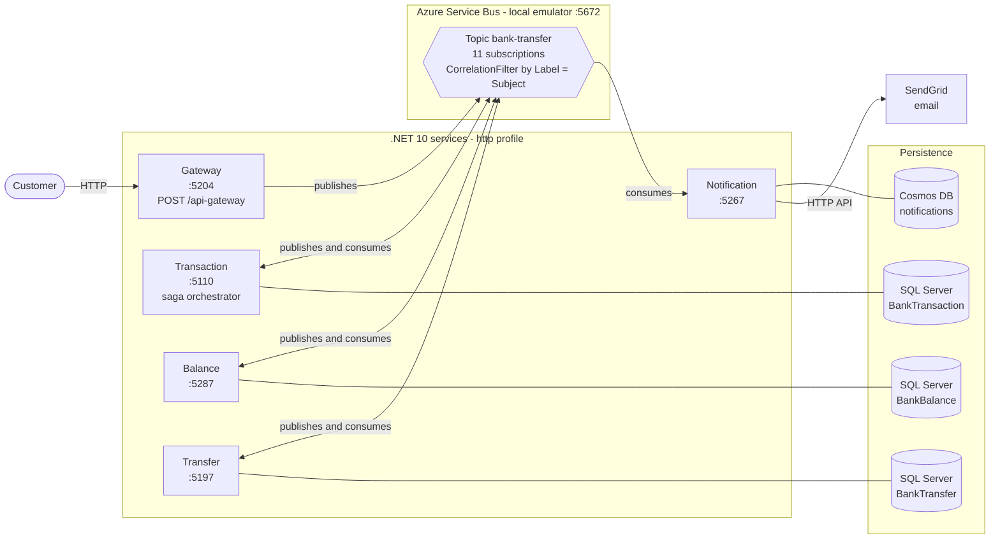
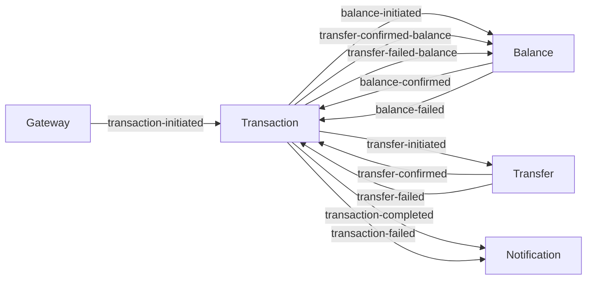
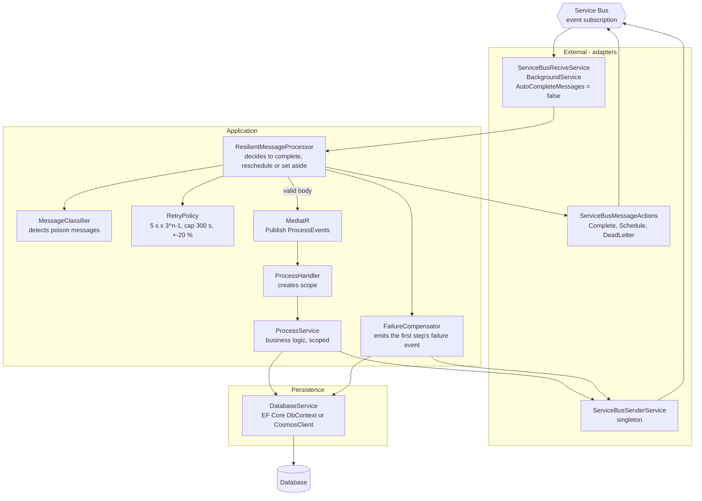

# 1. Architecture

.NET 10 microservices with a **choreographed saga** on **Azure Service Bus** (a single topic `bank-transfer`, one subscription per event filtered by `Subject`). No service calls another over HTTP: they only communicate through events.

## 1.1 Components and infrastructure

## 1.2 Event map (who publishes and who consumes)

Each arrow is an event that travels through the topic. The event name goes in `ServiceBusMessage.Subject` and matches the subscription name.

| Event (subscription) | Published by | Consumed by |
|---|---|---|
| `transaction-initiated` | Gateway | Transaction |
| `balance-initiated` | Transaction | Balance |
| `balance-confirmed` | Balance | Transaction |
| `balance-failed` | Balance | Transaction |
| `transfer-initiated` | Transaction | Transfer |
| `transfer-confirmed` | Transfer | Transaction |
| `transfer-failed` | Transfer | Transaction |
| `transaction-completed` | Transaction | Notification |
| `transaction-failed` | Transaction (and its own compensation) | Notification |
| `transfer-confirmed-balance` | Transaction | Balance |
| `transfer-failed-balance` | Transaction | Balance |

## 1.3 Internal structure of each service (layers)

It is the same structure in the five services. The code in `Application/Resilience/` is deliberately duplicated in four of them (the project's constitution forbids a shared project).

## 1.4 Observations to review (found while reading the code)

- **Balance has no idempotency of its own**: `ProcessDataBase` looks up by `CorrelationId` and, if it does not exist, inserts; it does not catch uniqueness violations nor protect final states. Transaction and Transfer do.
- **Notification does not compensate** (`NullFailureCompensator`) and is not idempotent: a duplicate `transaction-completed` would send the email twice. In addition, the email recipient is fixed in the code.
- **Double-emission window**: without the Outbox pattern, an event can be emitted more than once if the process crashes right between sending and confirming (documented in `specs/001`). That is why all consumers must be idempotent.
- `ResilientMessageProcessorTests` in the four test projects only covers the happy case; the file's comment describes it as "andamiaje" (scaffolding).
