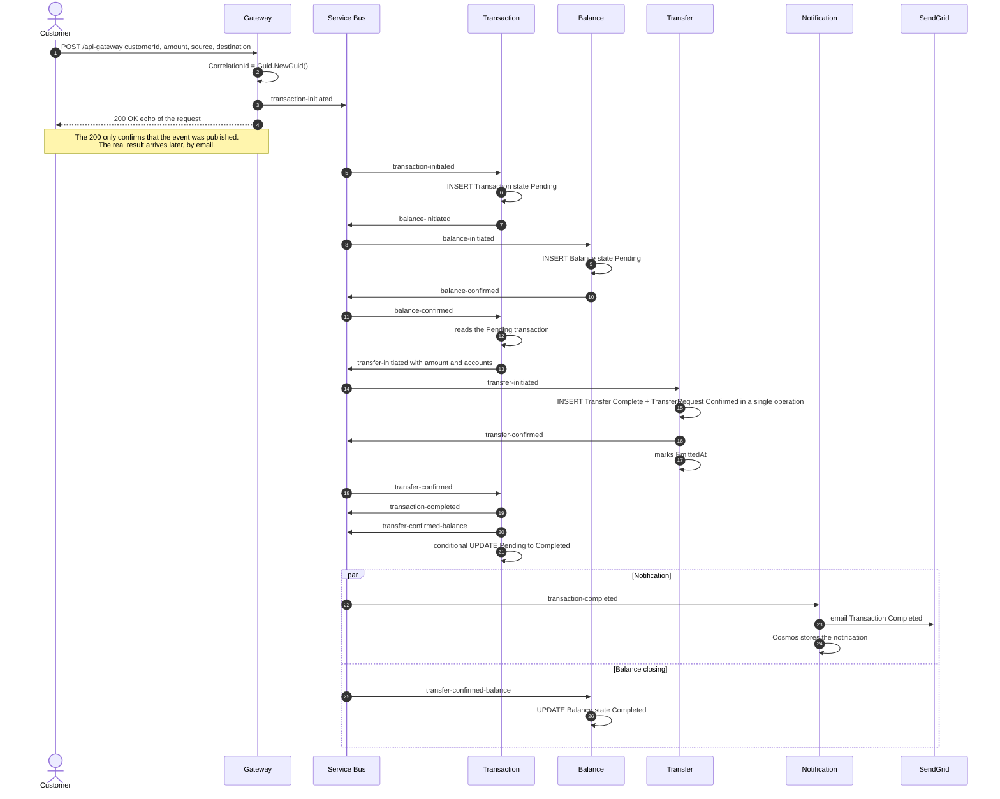
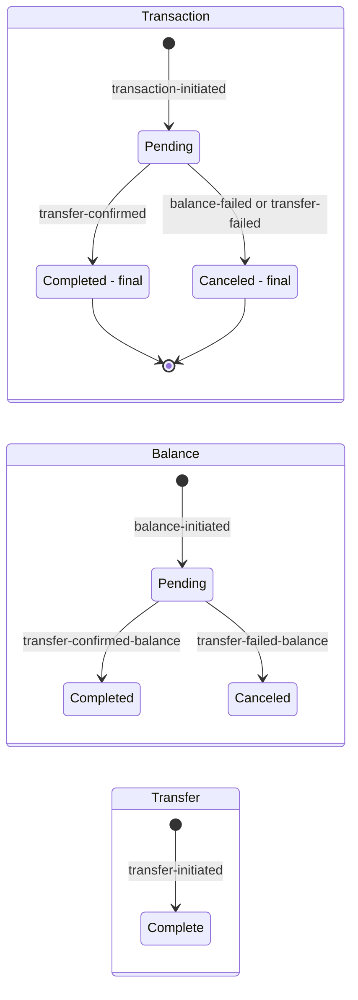

# 2. End-to-end flow (happy path)

A transfer from the moment it enters through the Gateway until the customer is notified. The `CorrelationId` is generated in the Gateway (`Guid.NewGuid()`) and travels in all events: it is the idempotency key in each database.

## 2.1 Sequence

## 2.2 States per service during the flow

> `Completed` and `Canceled` in Transaction are **final**: no duplicate or late message changes them (the transition is an `UPDATE ... WHERE CurrentState = 'Pending'`).

## 2.3 Data timeline

| Step | Service | Writes | Emits |
|---|---|---|---|
| 1 | Gateway | nothing (no database) | `transaction-initiated` |
| 2 | Transaction | `Transaction` = Pending | `balance-initiated` |
| 3 | Balance | `Balance` = Pending | `balance-confirmed` |
| 4 | Transaction | nothing (only reads) | `transfer-initiated` |
| 5 | Transfer | `Transfer` = Complete and `TransferRequest` = Confirmed | `transfer-confirmed` |
| 6 | Transaction | `Transaction` = Completed (after emitting) | `transaction-completed` and `transfer-confirmed-balance` |
| 7a | Notification | Cosmos: email-type notification | email through SendGrid |
| 7b | Balance | `Balance` = Completed | nothing |
