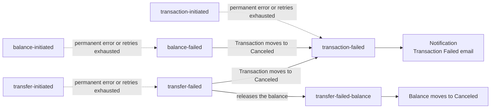
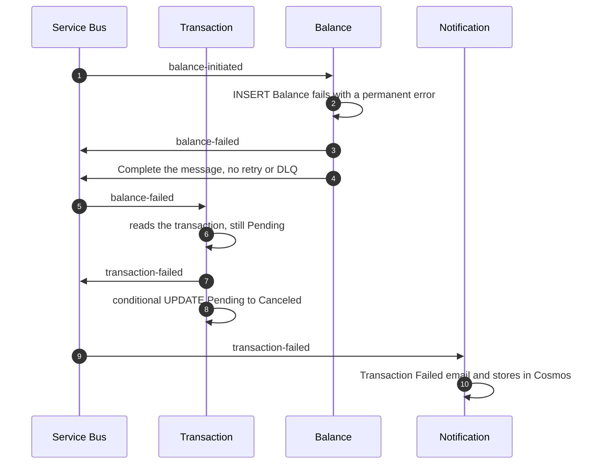
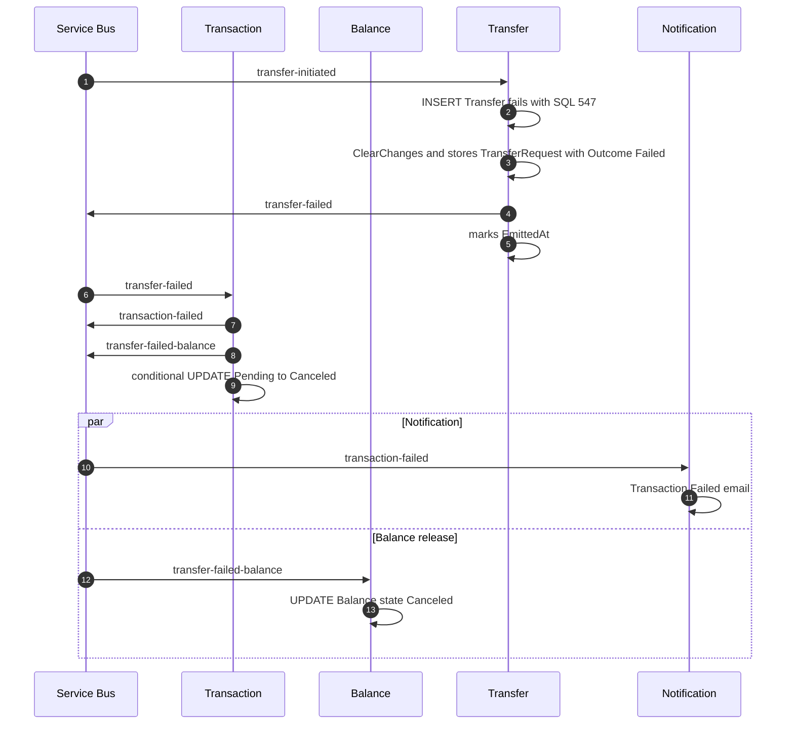
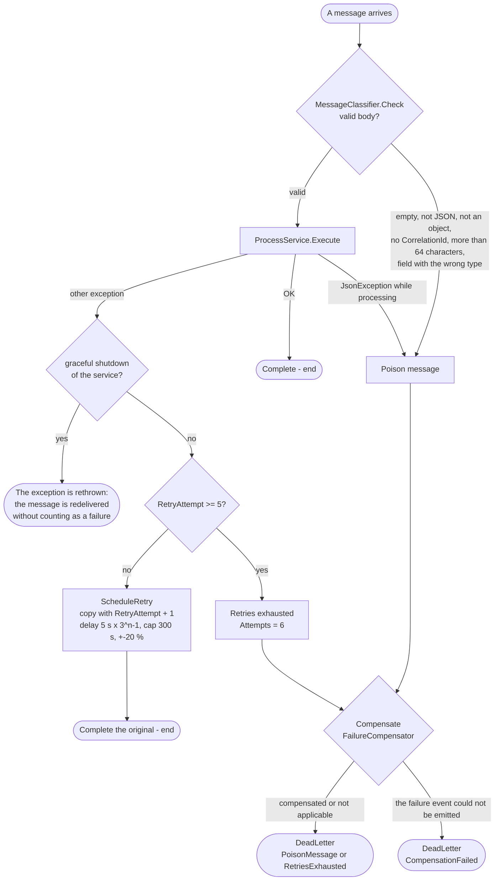
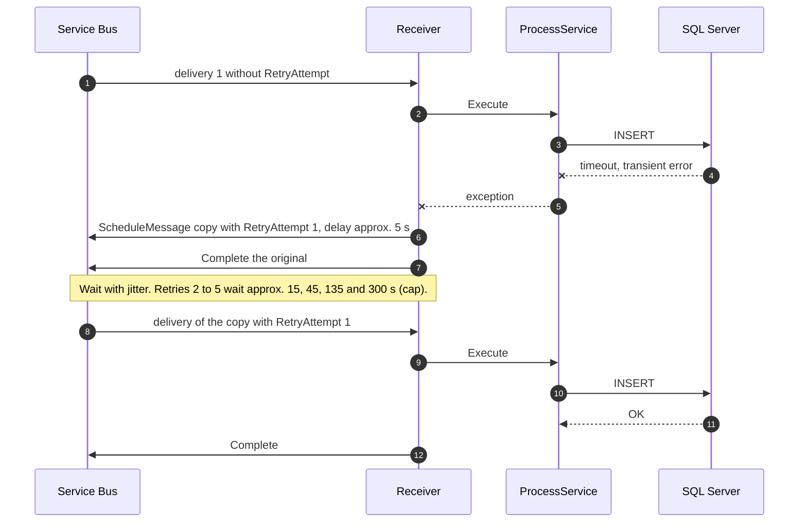
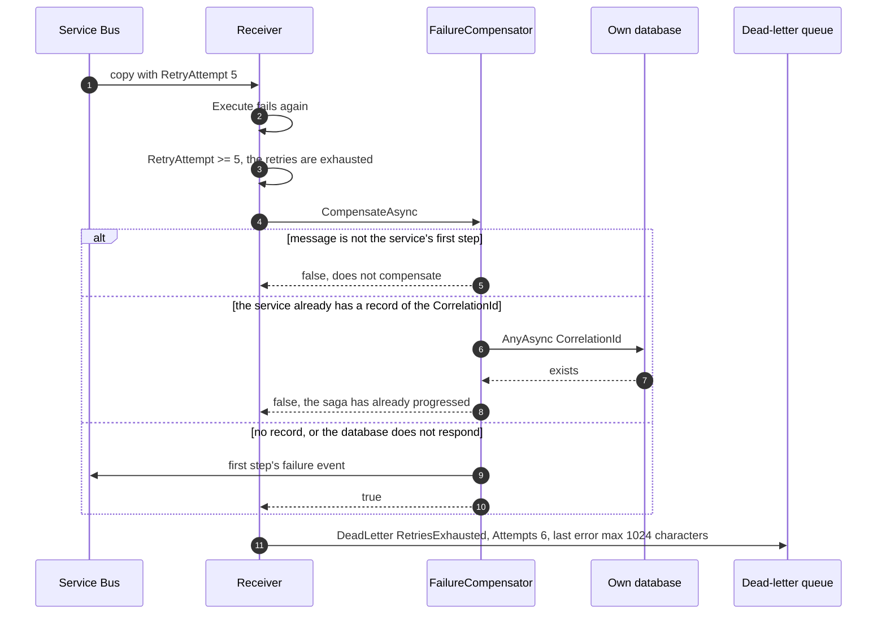
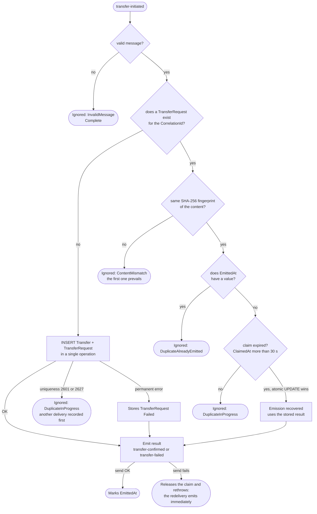
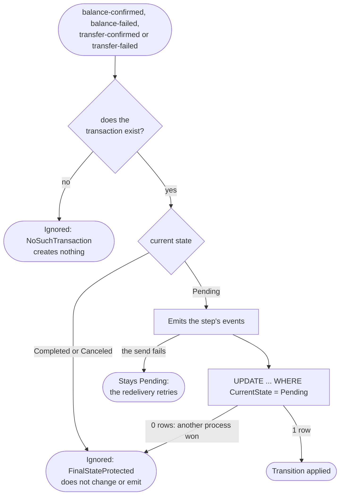

# 3. Failure flows

There are two families of failure and they are handled differently:

- **Permanent business or data failures** (for example a CHECK constraint): the service resolves them inside `ProcessService` by emitting a `*-failed` event. There is no retry or DLQ.
- **Infrastructure or message failures** (unreadable message, database down, Service Bus down): `ResilientMessageProcessor` resolves them with retries, compensation and the dead-letter queue.

## 3.1 Saga compensation map

Dotted lines: the service that receives the first step emits its own failure event. Solid lines: Transaction reacts and propagates.

## 3.2 Failure in Balance (permanent data error)

Example: a database constraint rejects the balance (SQL 515, 547, 8115 or 8152). It is not retried: it is compensated immediately.

## 3.3 Failure in Transfer (rejected transfer)

Example from the tests: an amount greater than or equal to 20000 violates a CHECK (SQL 547). Transfer records the rejection so that a repetition does not emit a second failure.

## 3.4 The consumer's decision on a message (`ResilientMessageProcessor`)

All the services use `AutoCompleteMessages = false`; the processor decides what to do with each message.

Key rules:

- The rescheduled copy is scheduled **before** completing the original. If something fails in between, there is a possible duplicate but never a loss.
- The Service Bus processor's `ProcessError` **only logs** (`ProcessorErrorHandler`): it does not set aside, complete or compensate.
- Each message set aside or rescheduled is logged with `CorrelationId`, `MessageId`, `MessageType`, `Attempt`, `Classification` and `Reason`.

## 3.5 Retry after a transient failure

Example: Transaction cannot reach its database while processing `transaction-initiated`.

## 3.6 Retries exhausted and compensation

The failure event according to the message that exhausted the retries:

| Message | Service | Compensation event |
|---|---|---|
| `transaction-initiated` | Transaction | `transaction-failed` |
| `balance-initiated` | Balance | `balance-failed` |
| `transfer-initiated` | Transfer | `transfer-failed` |
| any other | any | none (DLQ only) |
| any | Notification | none (`NullFailureCompensator`) |

The payload is `{CorrelationId, CustomerId}`. `CustomerId` is **omitted** if it could not be read, because an explicit `null` would make the consumer reject it as poison.

## 3.7 Duplicates and late messages

### Transfer: a single transfer and a single result

### Transaction: final states protected

Only `transaction-initiated` can **create** the Transaction row. If it arrives repeated while it is `Pending`, it emits `balance-initiated` again to recover a send that failed earlier.
