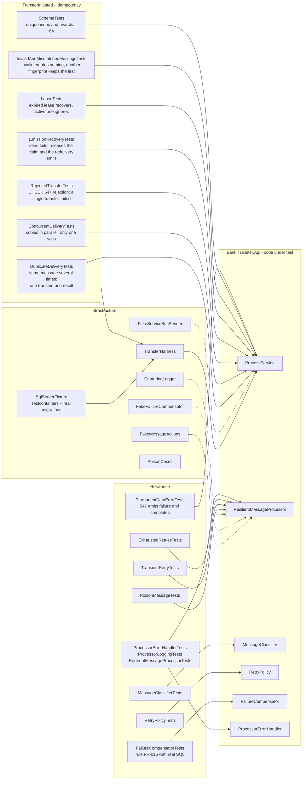
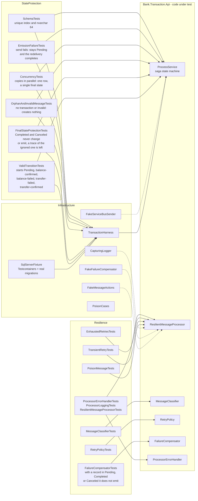
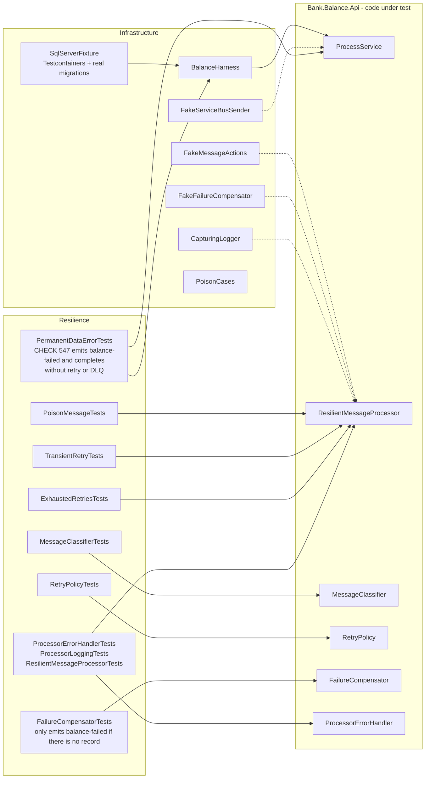
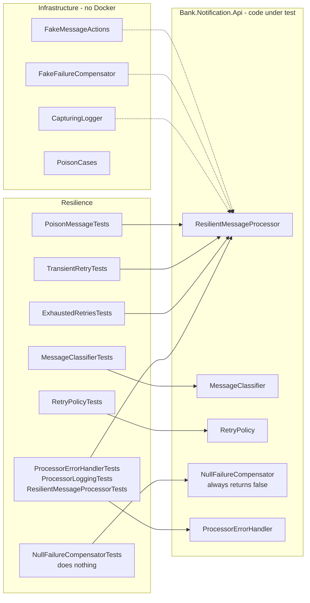

# 4. Test projects

One test project per service (xUnit). None references more than one service. Transfer, Transaction and Balance use a **real SQL Server in a container (Testcontainers)** with the real migrations, so they require Docker to be running. Notification does not use a database.

Common test doubles: `FakeMessageActions` (records Complete, Schedule and DeadLetter), `FakeFailureCompensator`, `CapturingLogger` and `PoisonCases` (sample poison bodies).

## 4.1 Bank.Transfer.Api.Tests

The most complete one: it covers resilience **and** the idempotency of `transfer-initiated`.

## 4.2 Bank.Transaction.Api.Tests

It covers resilience and the saga's **state protection** (`StateProtection`).

## 4.3 Bank.Balance.Api.Tests

It only covers resilience. **There are no idempotency or state-protection tests**, because Balance does not implement that behavior yet.

## 4.4 Bank.Notification.Api.Tests

No database, no Docker and no `FakeServiceBusSender`: Notification emits no events and has no real compensator.

## 4.5 What each project covers (summary)

| Area | Transfer | Transaction | Balance | Notification |
|---|:---:|:---:|:---:|:---:|
| Poison message classification | yes | yes | yes | yes |
| Retries with delay and jitter | yes | yes | yes | yes |
| Exhausted retries and DLQ | yes | yes | yes | yes |
| Structured logging and processor errors | yes | yes | yes | yes |
| Compensation (`FailureCompensator`) | yes | yes | yes | not applicable |
| Permanent data error | yes | no | yes | not applicable |
| Duplicate idempotency and lease | yes | no | no | no |
| Final-state protection | not applicable | yes | no | no |
| Concurrency | yes | yes | no | no |
| Schema (unique index, nvarchar 64) | yes | yes | no | no |
| Requires Docker | yes | yes | yes | no |
